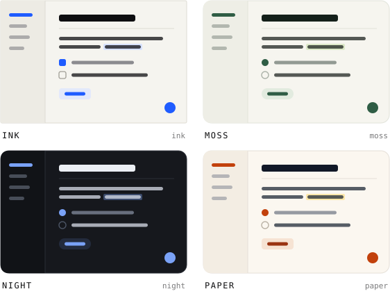

<div align="center">

<picture>
  <source media="(prefers-color-scheme: dark)" srcset="assets/lockup-clean-white.svg">
  
</picture>

**Community plugins and themes for [Loam](https://github.com/Azilone/loam).**

Everything here is installable from Loam in one click, reviewed by a person, and pinned to the exact code that was read.

[](https://github.com/Azilone/loam-community/actions/workflows/check.yml)

</div>

<picture>
  <source media="(prefers-color-scheme: dark)" srcset="assets/themes-dark.svg">
  
</picture>

## Install

**In the app:** Settings > Appearance for themes, Settings > Plugins for plugins.

**From the terminal:**

```bash
loam themes.install id=moss
loam plugin install --catalog word-count
```

## Publish a theme

A theme is one JSON file: colours, fonts and a few switches, no code ([the format](https://github.com/Azilone/loam/blob/main/docs/THEMES.md)).

1. Fork this repository.
2. Add `themes/<id>.json`. Start from [`themes/paper.json`](themes/paper.json).
3. List it in [`themes.json`](themes.json):
   ```json
   { "id": "my-theme", "name": "My Theme", "author": "your-github-name",
     "description": "One line about how it looks.", "version": "1.0.0", "appearance": "auto" }
   ```
4. Run `python3 check.py`, then open a pull request.

## Publish a plugin

A plugin lives in its own repository; this one only points to a reviewed commit of it.

1. Tag the release in your plugin's repository: `version` in plugin.json, then `git tag v1.2.0 && git push --tags`.
2. Get the commit: `git rev-parse v1.2.0^{commit}`.
3. Add it to [`index.json`](index.json) and open a pull request:
   ```json
   { "id": "word-count", "name": "Word Count", "description": "Counts the words of the open note.",
     "author": "your-github-name", "repo": "https://github.com/you/loam-word-count",
     "versions": [ { "version": "1.2.0", "tag": "v1.2.0", "commit": "<40-character sha>",
                     "minSDK": "1.12", "permissions": ["vault.read"] } ] }
   ```

New versions go at the end of `versions`; keep the old ones, so a Mac with an older Loam still finds one it can build.
New to plugins? [Writing plugins](https://github.com/Azilone/loam/blob/main/docs/WRITING-PLUGINS.md), or `loam plugin new`.

## How it stays safe

- `check.py` runs on every pull request: for a plugin, the tag exists, points to the pinned commit, and its plugin.json
  matches; for a theme, every key and colour is valid.
- A maintainer reads the code before merging. Loam refuses any commit this catalog does not pin, so a moved tag or a
  taken-over repository never installs.
- A plugin asks for permissions (`vault.read`, `network`…); Loam shows them before it runs, and again if an update asks
  for more. A theme has none: it cannot run code.

More in [CONTRIBUTING.md](CONTRIBUTING.md).
